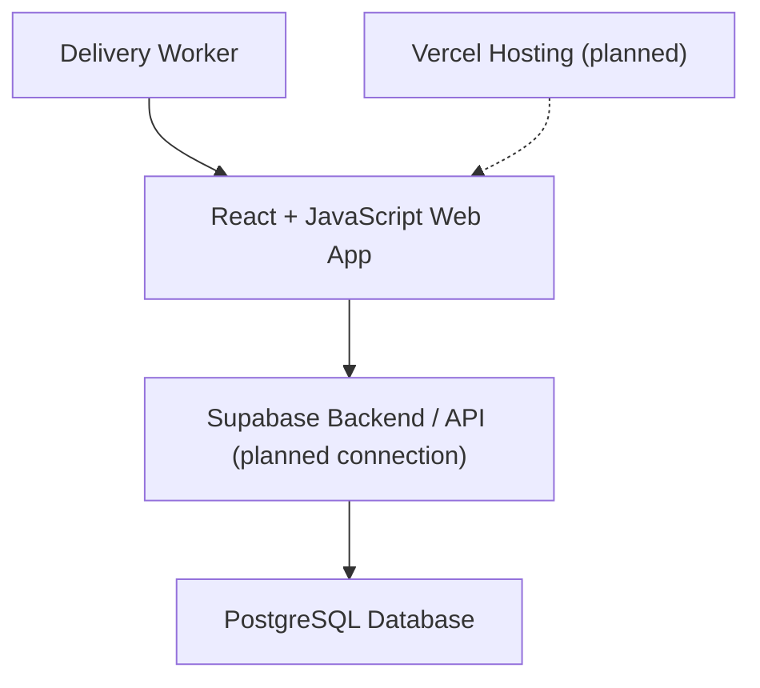

# Delivery Business App

## 1. Understand the User

### 1. Who am I in the context of this problem?

I am a computer science student helping a family member find a solution to problems in their business. I am not a delivery worker myself, but I have observed the difficulties workers experience and want to understand their needs before deciding what to build.

### 2. The Last Three Situations and What They Cost

**Situation 1: Driving Between Stores**

Workers drive between stores without an organized visiting order. They try to remember which stores are nearby and which ones they have not visited. Sometimes they check papers or messages or drive around to find another store.

What it costs: Extra driving time, unnecessary fuel expenses and the possibility of missing stores or deliveries.

**Situation 2: Confusion About Payment Collection**

A worker visits a store but is unsure whether the store has already paid or still owes money. Since payment information is written in different notebooks or shared through messages, the worker has to check with another worker or look through previous records. This wastes time and can result in missed payments or unnecessary trips back to the store.

What it costs: Extra time checking payment records, possible missed collections, and confusion between workers.

**Situation 3: Missing a Store During Deliveries**
Workers sometimes forget to visit a store because they have several deliveries to complete and no organized list showing which stores have already been visited. They may realize later that a store was missed and have to return to that area to complete the delivery.

What it costs: Extra driving time, additional fuel expenses, delayed deliveries, and frustration for both workers and store owners.

---

## 2. Define the Problem

### Problem Statement

I need a way to organize daily store visits and track deliveries and payments because workers currently rely on memory, notebooks, and messages, wasting at least two hours a day and sometimes missing deliveries or forgetting to collect money.

### Five Whys

**1. Why do workers waste time during deliveries?**

Because they struggle to remember which stores they need to visit, which they have already visited, and which deliveries or collections they need to complete.

**2. Why do workers struggle to keep track of stores and daily tasks?**

Because store addresses, delivery information, and payment records are not organized in one clear, consistent place.

**3. Why is the information not organized in one place?**

Because workers currently rely on notebooks, papers, memory, and messages to share and track information.

**4. Why does relying on separate records cause problems?**

Because information can be difficult to find, update, and share. Workers may not know the latest delivery status or which businesses have paid or still owe money.

**5. Why is having one organized source of information important?**

Because current and future workers need access to clear, up to date business information so they can understand their daily responsibilities, keep track of deliveries and payments and continue the work without relying on another worker's memory or scattered records.

### Complete Problem Description

When delivery workers start their workday and travel between delis, grocery stores, and markets, they struggle to organize which stores to visit, which deliveries or collections are due and which businesses have paid or still owe money.

This costs them at least two hours per day, according to my estimate, and can lead to missed deliveries, unnecessary trips, forgotten collections and stress.

This happens because store addresses, delivery tasks, and payment records are scattered across notebooks, papers, memory and messages between workers.

Right now, workers check their notes and messages and try to remember which stores they have visited, but this process makes information difficult to find, update, and share consistently with current and future workers.

### I'll Know This Is Solved When...

- The app should make daily responsibilities easier to understand without requiring workers to search through multiple notebooks or messages.
- Delivery workers can easily identify which stores need to be visited each day.
- Workers know whether each stop requires a delivery or money collection.
- Workers spend less time searching and driving unnecessarily.
- Workers can accurately track which businesses have paid and which still owe money.
- Current and future workers can access the same clear, up-to-date business information.

---

## 3. Look at Existing Solutions

| What They Use | What It Does Well | Problems and Limitations |
|---|---|---|
| **Notebooks and papers** | Store information and keep written records. | Information is not organized in one clear place, making it difficult to find stores and track deliveries and payments. |
| **Messages between workers** | Allow workers to share information and communicate. | Information can get scattered across conversations, making it difficult to find updates and know which information is current. |
| **Memory** | Helps workers remember familiar stores and locations. | Workers can forget visits, deliveries, collections, and payment information, especially when they have many responsibilities. |

## 4. Features & Benefits

### Implemented MVP Features

| Feature | What the current app does |
|---|---|
| Store Management | Add stores with a name and address, and view the store list. |
| Delivery Tracking | Create deliveries for a selected store, view pending and completed deliveries, and mark individual deliveries as completed. Delivery status is tracked separately from payment status. |
| Payment Tracking | Select a store, record an amount owed and an amount collected, and view its remaining balance and payment status. Workers can also mark a store as fully paid; when there is an outstanding balance, the app asks for confirmation before recording it as collected. |

The app also shows store balance groups for **Still Owe**, **Fully Paid**, and **No Balance Recorded**, along with delivery-status summaries. Payment and delivery statuses are independent.

### My MVP

My first version focuses on organizing store information, tracking deliveries, and recording payments. The current implementation is a local React website its information is temporary and is not yet shared or saved to a database.

### Future Features (Not Yet Implemented)

Worker accounts and assignments, GPS and closest-stop suggestions, a manager dashboard, advanced route optimization, automatic payment processing, and detailed business reports are future ideas. They are not included in the current MVP.

## 5. Tech Stack

| Part | Technology | Status |
|---|---|---|
| Front end | React and JavaScript | Implemented |
| Development/build tool | Vite | Implemented in the `client` folder |
| Back end and database | Supabase and PostgreSQL | Planned. Database tables have been started, but Supabase is not connected to the React app. |
| Hosting | Vercel | Planned. The app currently runs locally and is not deployed. |
| Version control | Git and GitHub | Used to save and track project changes. |

### How the App Will Work

In the current version, Vite runs the React app locally in a browser. React displays the store list, delivery tracking, and payment forms. The app temporarily keeps this information in React state; it is not currently saved permanently.

In a future version, the React app is planned to connect to Supabase, which will store the information in a PostgreSQL database. Vercel hosting is also planned so workers can access the app online.

### Why I Chose This Stack

I chose these technologies because they have beginner tutorials, documentation, and tools that can help me build my first application. I want to start with a simple version and add more features as I learn.

### Planned Architecture



## Current Implementation Status

- The implemented MVP runs locally from the Vite project in the `client` folder.
- Store, delivery, and payment information is held temporarily in React state. It can disappear when the page is refreshed or closed.
- Supabase is not connected to the React app. Database tables have been started, and permanent database storage is planned.
- The app is not deployed. Vercel hosting is planned.

To run the app locally, open a terminal in the `client` folder and run:

```bash
npm run dev
```

## Demo

(https://drive.google.com/file/d/15-3cyccKm_O64wUzgSTXtd5zQsx9Haxp/view?usp=sharing)