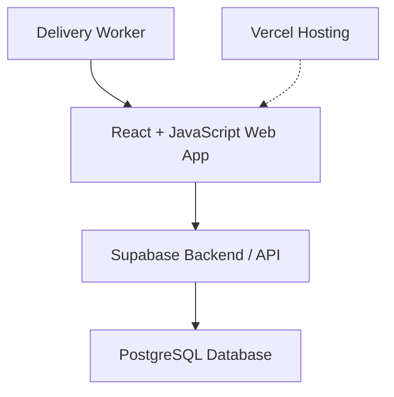

# Delivery Business App

## 1. Understand the User

### 1. Who am I in the context of this problem?

I am a computer science student helping a family member find a solution to problems in their business. I am not a delivery worker myself, but I have observed the difficulties workers experience and want to understand their needs before deciding what to build.

### 2. The Last Three Situations and What They Cost

**Situation 1: Driving Between Stores**

Workers drive between stores without an organized visiting order. They try to remember which stores are nearby and which ones they have not visited. Sometimes they check papers or messages or drive around to find another store.

What it costs: Extra driving time, unnecessary fuel expenses, and the possibility of missing stores or deliveries.

**Situation 2: Confusion About Payment Collection**

A worker visits a store but is unsure whether the store has already paid or still owes money. Since payment information is written in different notebooks or shared through messages, the worker has to check with another worker or look through previous records. This wastes time and can result in missed payments or unnecessary trips back to the store.

What it costs: Extra time checking payment records, possible missed collections, and confusion between workers.

**Situation 3: Missing a Store During Deliveries**
Workers sometimes forget to visit a store because they have several deliveries to complete and no organized list showing which stores have already been visited. They may realize later that a store was missed and have to return to that area to complete the delivery.

What it costs: Extra driving time, additional fuel expenses, delayed deliveries, and frustration for both workers and store owners.

---

## 2. Define the Problem

### Problem Statement

I need a way to organize daily store visits and track deliveries and payments because workers currently rely on memory, notebooks, and messages, wasting at least two hours a day and sometimes missing deliveries or forgetting to collect money.

### Five Whys

**1. Why do workers waste time during deliveries?**

Because they struggle to remember which stores they need to visit, which they have already visited, and which deliveries or collections they need to complete.

**2. Why do workers struggle to keep track of stores and daily tasks?**

Because store addresses, delivery information, and payment records are not organized in one clear, consistent place.

**3. Why is the information not organized in one place?**

Because workers currently rely on notebooks, papers, memory, and messages to share and track information.

**4. Why does relying on separate records cause problems?**

Because information can be difficult to find, update, and share. Workers may not know the latest delivery status or which businesses have paid or still owe money.

**5. Why is having one organized source of information important?**

Because current and future workers need access to clear, up-to-date business information so they can understand their daily responsibilities, keep track of deliveries and payments, and continue the work without relying on another worker's memory or scattered records.

### Complete Problem Description

When delivery workers start their workday and travel between delis, grocery stores, and markets, they struggle to organize which stores to visit, which deliveries or collections are due, and which businesses have paid or still owe money.

This costs them at least two hours per day, according to my estimate, and can lead to missed deliveries, unnecessary trips, forgotten collections, and stress.

This happens because store addresses, delivery tasks, and payment records are scattered across notebooks, papers, memory, and messages between workers.

Right now, workers check their notes and messages and try to remember which stores they have visited, but this process makes information difficult to find, update, and share consistently with current and future workers.

### I'll Know This Is Solved When...

- The app should make daily responsibilities easier to understand without requiring workers to search through multiple notebooks or messages.
- Delivery workers can easily identify which stores need to be visited each day.
- Workers know whether each stop requires a delivery or money collection.
- Workers spend less time searching and driving unnecessarily.
- Workers can accurately track which businesses have paid and which still owe money.
- Current and future workers can access the same clear, up-to-date business information.

---

## 3. Look at Existing Solutions

| What They Use | What It Does Well | Problems and Limitations |
|---|---|---|
| **Notebooks and papers** | Store information and keep written records. | Information is not organized in one clear place, making it difficult to find stores and track deliveries and payments. |
| **Messages between workers** | Allow workers to share information and communicate. | Information can get scattered across conversations, making it difficult to find updates and know which information is current. |
| **Memory** | Helps workers remember familiar stores and locations. | Workers can forget visits, deliveries, collections, and payment information, especially when they have many responsibilities. |

## 4. Features & Benefits

| Feature | Benefit | Priority |
|---|---|---|
| Shared store list with addresses | Workers can find stores and know which ones need visits. | MVP |
| Delivery tracking | Workers can record deliveries and mark them completed. | MVP |
| Payment tracking | Workers can record payments and see outstanding balances. | MVP |
| Worker accounts and assignments | Workers can see their assigned deliveries. | Later |
| GPS and closest-stop suggestions | Workers can find nearby unfinished stops. | Later |
| Manager dashboard | Managers can review deliveries and payments. | Later |

### My MVP

My first version will focus on organizing store information, tracking completed deliveries, and recording payments. These features will help workers keep important information in one place instead of relying on notebooks, messages, and memory.

### Not Doing Yet

The first version will not include advanced route optimization, automatic payment processing, or detailed business reports. These features may be considered in future versions.

## 5. Tech Stack

| Part | Technology | Why I Chose It |
|---|---|---|
| Front End | React and JavaScript | To build the screens, forms, and buttons for the delivery app. |
| Back End | Supabase | To manage and retrieve delivery and payment information. |
| Database | Supabase PostgreSQL | To store information about stores, deliveries, and payments. |
| Hosting | Vercel | To publish the app online so workers can access it. |
| Version Control | Git and GitHub | To save changes and track my progress. |

### How the App Will Work

Workers will open the app in their browser. React will display the store list, deliveries, and payment forms. Supabase will securely store the information in a database. Vercel will host the app online.

### Why I Chose This Stack

I chose these technologies because they have beginner tutorials, documentation, and tools that can help me build my first application. I want to start with a simple version and add more features as I learn.

### Architecture Diagram

## START THE PROJECT 
- FINISH THIS PROJECT 